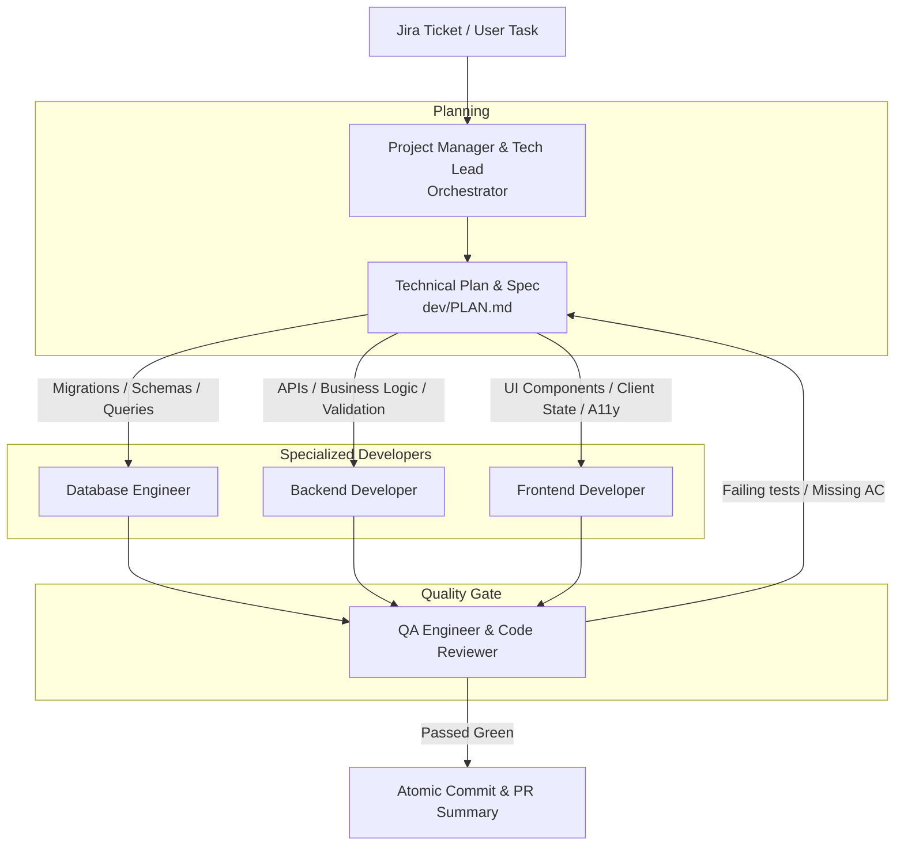
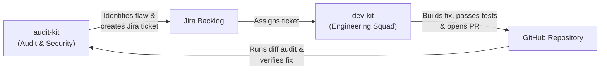

# dev-kit

Current version: **0.10.0** (see `CHANGELOG.md`). Full documentation: [docs/GUIDE.md](docs/GUIDE.md). Protocol & workflow: [RUN.md](RUN.md).

A portable autonomous software engineering squad: a **Project Manager & Tech Lead** orchestrator, specialized developers (**Database**, **Backend**, **Frontend**), and an independent **QA Engineer** quality gate that guarantees test suites pass and acceptance criteria are met before opening Pull Requests.

Drop this folder into the root of any repository. It works with Antigravity (Gemini), Claude Code, Cursor, Windsurf, GitHub Copilot or any agent that can edit files and run terminal commands.

---

## Set up a new project

### 1. Install the kit

From the root of the project you want to develop on:

```bash
curl -fsSL https://raw.githubusercontent.com/victorfigueira/dev-kit/main/get.sh | bash
```

This downloads the kit into `dev-kit/` and installs the commands for Claude Code, Antigravity, and Cursor. For one tool only, add its name at the end: `| bash -s -- antigravity` (or `claude`, `cursor`). To pin a version, put `DEV_KIT_REF=v0.10.0` before `bash`.

Keep squad working plans, temporary files, and the kit copy out of git:

```bash
echo "dev/" >> .gitignore
echo "dev-kit/" >> .gitignore
```

### 2. Fill in the project context

Reload the IDE window, then paste this into the agent chat:

```
Fill in dev/project-context.md from the README, package.json, pyproject.toml, docker-compose.yml and folder structure. Detect the exact test commands (unit/integration, typecheck, lint) and the database migration runner. Mark anything you are not sure about with TO CONFIRM. Do not change any other file.
```

Review the file and resolve every `TO CONFIRM` by hand. This step configures the test commands that the QA Quality Gate executes.

### 3. Run the development squad

Run `/dev <TICKET_KEY>`. Without a key, the Tech Lead proposes the top-priority ticket from your Jira backlog and waits for you to confirm it.

The squad stops twice for your approval: once the plan is written (before it creates the branch, writes code or touches Jira) and once QA has approved and the work is committed locally (before it pushes, comments on Jira or moves the ticket). Add `continuous` to carry on with the next backlog ticket after each delivery, and `unattended` to skip both approvals; the squad never assumes either. See the modes table in [RUN.md](RUN.md).

| Tool | Squad (`/dev`) | QA Quality Gate Only | Technical Plan Only |
|---|---|---|---|
| **Antigravity** | `/dev [TICKET_KEY] [continuous] [unattended]` | `/dev-qa` | `/dev <ticket>`, then reject at plan approval |
| **Claude Code** | `/dev [TICKET_KEY] [continuous] [unattended]` | `/dev-qa` | `/dev <ticket>`, then reject at plan approval |
| **Cursor** | "Follow dev-kit/RUN.md (`/dev`)" | "Follow dev-kit/agents/qa.md" | "Write dev/PLAN.md using dev-kit/templates/PLAN.md" |
| **Any other agent** | "Follow dev-kit/RUN.md (`/dev`)" | "Run python3 dev-kit/tools/test_runner.py" | "Fill in dev-kit/templates/PLAN.md" |

### Update the kit in a project

Every `/dev` run checks for a newer version first, summarises what is new and installs it only after you confirm (add `no-update` to skip the check, for example `/dev PAS-1 no-update`). You can also run `/dev-check-update` in the agent chat (Claude Code or Antigravity). The update replaces `dev-kit/`, refreshes the kit's own adapters and keeps `dev/`. Reload the IDE window afterwards. The steps are in [UPDATE.md](UPDATE.md).

### Private repository or no curl

With the GitHub CLI:

```bash
gh api repos/victorfigueira/dev-kit/contents/get.sh -H "Accept: application/vnd.github.raw" | DEV_KIT_REPO=git@github.com:victorfigueira/dev-kit.git bash
```

Or manually: clone or copy the `dev-kit/` folder into your project root and run `bash dev-kit/install.sh`.

---

## What you get

All development artifacts go to `dev/` in your project:

- `PLAN.md`: Technical specification, architectural scope, Squad Delivery Matrix, and sequenced steps.
- `PULL_REQUEST.md`: Pull request summary with Squad Delivery Scorecard, Token & USD Cost calculation, full test execution evidence, and Jira ticket cross-links.
- `project-context.md`: Project-specific test commands, migration runners, and branching rules.
- **Git Feature Branch:** `feat/<TICKET_KEY>-<slug>` created cleanly from `main`.
- **Atomic Commits:** Conventional commits (`feat: ...`, `fix: ...`) verified by QA tests, staging only the files in the plan.
- **Jira Status Transitions:** *In Progress* once you approve the plan, *In Review* once you approve the delivery.

---

## The Engineering Squad



### Roles Breakdown

| Role | Agent File | Primary Responsibilities | Key Rules & Boundaries |
|---|---|---|---|
| **Project Manager & Tech Lead** | `agents/pm.md` | Ingests tickets, extracts Acceptance Criteria, formulates `dev/PLAN.md`, creates branches, and sequences work. | Never edits code directly. Enforces quality gate, anti-scope creep, and 3-iteration circuit breaker. |
| **Database Engineer (DBA)** | `agents/database.md` | Schema modeling, migration scripts (`up`/`down`), index optimization, and local test database verification. | Operates strictly in local/Docker environments. Enforces Expand & Contract, safe backfills, and PII encryption. |
| **Backend Developer** | `agents/backend.md` | REST/GraphQL endpoints, domain services, strict input validation schemas (Zod/Pydantic), and unit tests. | Never leaks raw database errors. Enforces AuthN/AuthZ, IDOR protection, and deterministic offline mocking. |
| **Frontend Developer** | `agents/frontend.md` | Reusable UI components, client state, styling tokens, and accessibility (a11y). | Mandatory implementation of all 4 states (Loading, Error, Empty, Success), mirrored form validation, and error boundaries. |
| **QA Engineer (Quality Gate)** | `agents/qa.md` | Independent verification: executes test suites via `test_runner.py`, proves every AC with a `file:line` and a passing test, and inspects `git diff`. | Sees only the plan and the diff, never the developers' reports. Zero failing tests policy; rejects tautological tests and unproven criteria. |

In Claude Code each role runs as its own subagent (`pm`, `database-engineer`, `backend-dev`, `frontend-dev`, `qa-verifier`) with a restricted tool list: the QA verifier cannot edit files. In Antigravity the orchestrator launches them with `invoke_subagent`. Every subagent prompt starts with `dev-kit-agent: <name>` so token usage can be attributed per role. See "Subagents" in [RUN.md](RUN.md).

---

## The 6-Stage Engineering Lifecycle

Every task follows the protocol defined in [`RUN.md`](RUN.md):

1. **Ingest & Triage:** Reads ticket key (e.g. `AK-101`) via `tools/jira_sync.py` or user brief and extracts Acceptance Criteria checkboxes.
2. **Technical Plan (`dev/PLAN.md`):** Formulates affected layers, file lists, and sequencing, then waits for your approval (Checkpoint 1).
3. **Feature Branch:** Creates `feat/<TICKET_KEY>-<slug>` from the latest base branch and moves Jira to *In Progress*.
4. **Specialized Build:** Executes in dependency order (Database migrations first $\rightarrow$ Backend API contracts second $\rightarrow$ Frontend UI third).
5. **Quality Gate:** The QA agent, working only from the plan and the diff, runs `tools/test_runner.py --typecheck --lint` and proves every Acceptance Criterion with a `file:line` and a passing test. If anything fails or lacks evidence, it sends a structured report back to the developer.
6. **Delivery & PR:** Once tests pass green, commits the planned files locally, writes `dev/PULL_REQUEST.md` with the cost measured from the session files, and asks before pushing and moving the Jira ticket to *In Review* (Checkpoint 2).

---

## Database Safety Standards

Database changes are the most critical operations in software engineering. `dev-kit` enforces strict standards in [`RULES.md`](RULES.md):

* **Expand & Contract Pattern:** Adding a column is always nullable or has a safe default. Deprecated columns are never dropped in the same release.
* **Reversible Migrations:** Every migration must provide both an `up` and `down` operation.
* **Local Isolation Only:** The database engineer connects exclusively to local Docker or test databases. Production and staging credentials are never used.
* **Transactional DDL:** Schema alterations are wrapped in transactions (`BEGIN ... COMMIT`) to prevent partial failure.

---

## Folder contents

| Path | Purpose |
|---|---|
| `RUN.md` | Squad instructions & step-by-step orchestrator execution protocol. |
| `VERSION` | Kit version, recorded in plans and pull requests. |
| `UPDATE.md` | Update check used by `/dev` and `/dev-check-update`. |
| `RULES.md` | Engineering standards: git branching, safe migrations, and quality gate rules. |
| `CHANGELOG.md` | Complete release history and roadmap notes. |
| `docs/GUIDE.md` | Full reference manual: workflows, roles, test runners, and Jira synchronization. |
| `agents/` | Tool-agnostic agent prompts (`pm.md`, `database.md`, `backend.md`, `frontend.md`, `qa.md`). |
| `templates/` | Templates for `PLAN.md`, `PULL_REQUEST.md`, and `project-context.md`. |
| `tools/test_runner.py` | Universal test suite runner auto-detecting Node, Python, Go, Rust, and .NET. |
| `tools/jira_sync.py` | Jira Cloud synchronization (fetches ACs, transitions status, posts comments). |
| `tools/cost_tracker.py` | Run record per ticket in `dev/runs.json` (tool, model, commit, kit version, QA rounds, tokens, cost) and `dev/COSTS.md` generated from it. |
| `tools/usage_report.py` | Sums tokens from Claude Code or Antigravity session files since the ticket start, per `dev-kit-agent` role. |
| `tools/pricing.json` | Model prices per 1M tokens (dated); override per project with `dev/pricing.json`. |
| `adapters/` | Thin wrappers for Antigravity, Claude Code, and Cursor. |
| `install.sh` | Local installer script that deploys commands and skills. |
| `get.sh` | One-liner curl installer for new repositories. |

---

## Where the adapters go

| Tool | Files Installed in Your Project |
|---|---|
| **Antigravity** | `.agents/skills/{dev,dev-feature,dev-qa,dev-check-update}/SKILL.md` |
| **Claude Code** | `.claude/commands/{dev,dev-feature,dev-qa,dev-check-update}.md`, `.claude/agents/{pm,database-engineer,backend-dev,frontend-dev,qa-verifier}.md` |
| **Cursor** | `.cursor/rules/dev.mdc` |
| **Shared** | `dev/project-context.md` |

Adapters are lightweight pointers to `dev-kit/`. To customize how an agent behaves, edit `agents/<role>.md` in `dev-kit/`, never the adapter.

---

## Sibling Ecosystem: `audit-kit` & `dev-kit`

`dev-kit` and [audit-kit](https://github.com/victorfigueira/audit-kit) form an autonomous closed-loop engineering cycle:



1. **`audit-kit`** inspects your codebase, finds security vulnerabilities (with CVSS scores), technical debt, or performance bottlenecks, and files Jira tickets.
2. **`dev-kit`** ingests those tickets, dispatches specialized developers (DBA, Backend, Frontend), verifies the fix with QA tests, and opens a Pull Request.
3. **`audit-kit`** re-runs in Diff mode on the PR to confirm the vulnerability is resolved and increases the project audit score.

---

## Safety & Isolation

* **Read/Write Boundaries:** Specialized developers edit only files within their layer. The PM and QA agents do not edit application code.
* **Local Test Execution:** The QA verifier runs tests locally within your normal development environment (e.g. `npm test`, `pytest`).
* **Zero Production Access:** `dev-kit` never requires or accepts production credentials.
