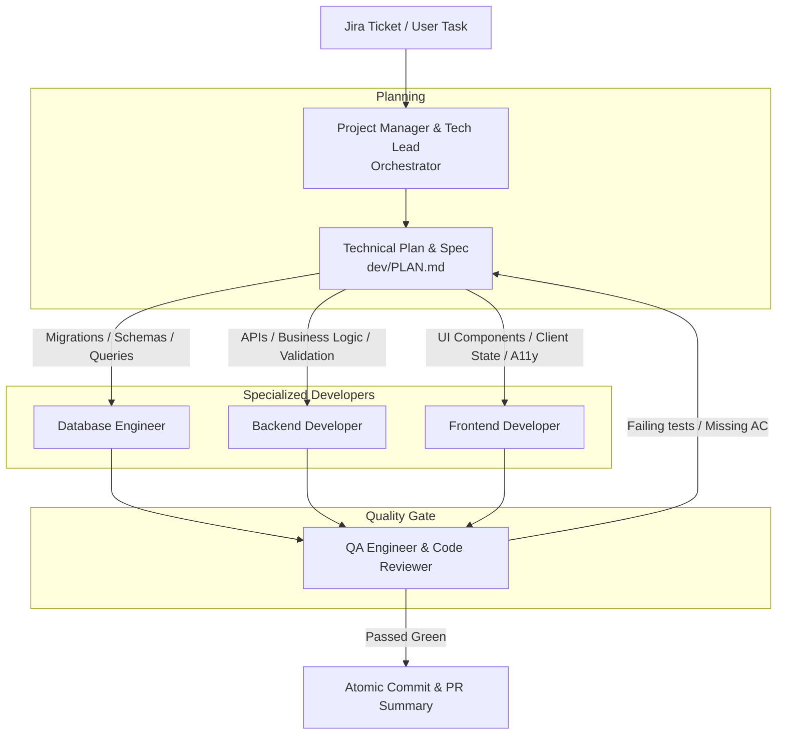

# dev-kit

Current version: **0.1.0** (see `CHANGELOG.md`). Protocol & workflow: [RUN.md](RUN.md).

A portable autonomous software engineering squad: a **Project Manager & Tech Lead** orchestrator, specialized developers (**Database**, **Backend**, **Frontend**), and a **QA Engineer** quality gate that guarantees test suites pass before opening Pull Requests.

Drop this folder into the root of any repository. It works with Antigravity (Gemini), Claude Code, Cursor, Windsurf, GitHub Copilot or any agent that can edit files and run terminal commands.

---

## The Engineering Squad



### Roles Breakdown
* **`pm` (Project Manager & Tech Lead):** Reads Jira tickets or prompts, extracts Acceptance Criteria, formulates `dev/PLAN.md`, creates feature branches, and coordinates developer agents in sequence.
* **`database` (Database & Persistence Engineer):** Designs safe schemas (Expand & Contract pattern), writes migrations with both `up` and `down`, optimizes indexes, and verifies migration runs against local/Docker test databases.
* **`backend` (Backend & API Developer):** Implements robust REST/GraphQL endpoints, enforces strict input validation (Zod/Pydantic), encapsulates business logic, and writes unit/integration tests.
* **`frontend` (Frontend & UI Developer):** Builds accessible (a11y) UI components, manages client state, and guarantees all 4 async states (Loading, Error, Empty, Success).
* **`qa` (QA Engineer & Quality Gate):** Independent reviewer that executes the project's test suite (`tools/test_runner.py`), verifies all Acceptance Criteria, and inspects `git diff` before approving commits.

---

## Installation

From the root of the project you want to develop on:

```bash
curl -fsSL https://raw.githubusercontent.com/victorfigueira/dev-kit/main/get.sh | bash
```

This installs `dev-kit/` and adds commands/skills for **Antigravity**, **Claude Code**, and **Cursor**.
For a single tool only, append its name:
```bash
... | bash -s -- antigravity   # or claude, cursor
```

To keep squad working files and tickets out of your git history:
```bash
echo "dev/" >> .gitignore
echo "dev-kit/" >> .gitignore
```

---

## Quickstart Commands

| Command | Purpose |
|---|---|
| `/dev-feature <TICKET_KEY>` | Launches the PM orchestrator to ingest the ticket, plan, dispatch devs, and pass QA |
| `/dev-qa` | Runs the independent Quality Gate test suite and diff review |

---

## The Sibling Ecosystem: `audit-kit` & `dev-kit`

`dev-kit` is designed to work in synergy with [audit-kit](https://github.com/victorfigueira/audit-kit):
1. **`audit-kit`** inspects your codebase, finds vulnerabilities, calculates CVSS scores, and files Jira tickets.
2. **`dev-kit`** ingests those Jira tickets, dispatches specialized developers to implement the fixes, and validates them with QA tests.
3. **`audit-kit`** re-runs in Diff mode to confirm the findings are resolved and increases the project audit score.
