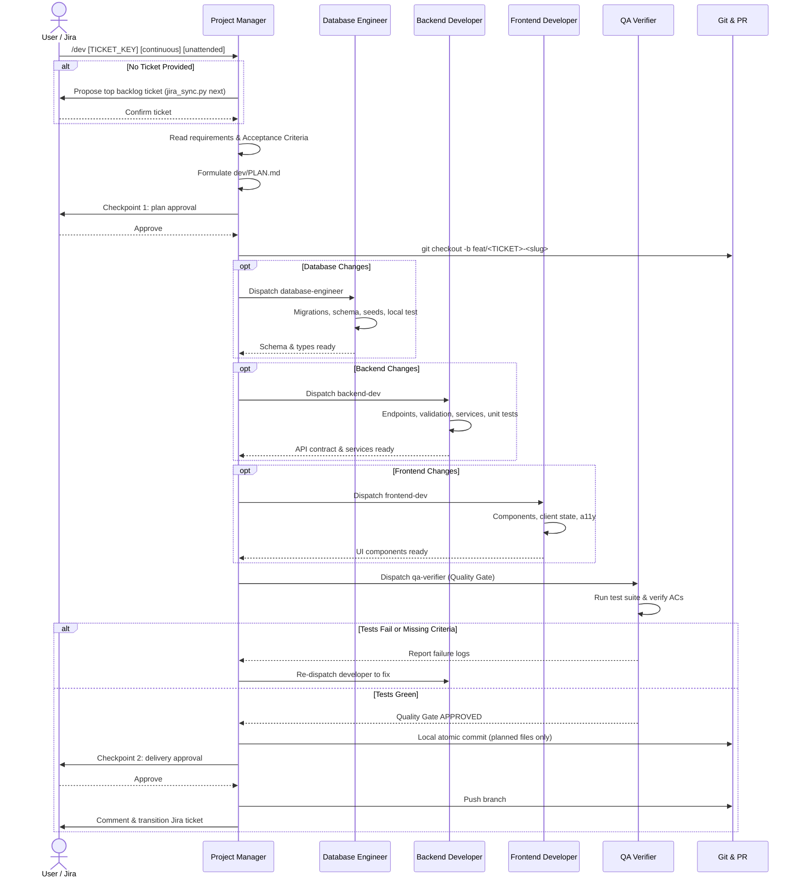

# dev-kit Execution Protocol

This document defines the exact step-by-step procedure the Project Manager / Tech Lead orchestrator follows to resolve tickets and implement features.

---

## Arguments and modes

| Argument | Effect |
|---|---|
| `<TICKET_KEY>` or a feature brief | Work on that ticket only. |
| *(none)* | Propose the top-priority backlog ticket (`jira_sync.py next`) and wait for the user to confirm it. |
| `continuous` | After a ticket is delivered, propose the next backlog ticket and keep going. Checkpoints still apply to every ticket. |
| `unattended` | Skip both checkpoints below. Valid only when the user typed it in this command; never infer it. With `continuous`, the squad works through the backlog without stopping. |
| `no-update` | Skip the update check (Step 0). |

## Checkpoints

The squad stops and waits for the user at two points. Without a clear yes it does not continue past them, unless the user passed `unattended`.

1. **Plan approval** (end of Step 2): before creating the branch, writing code or changing the Jira ticket.
2. **Delivery approval** (Step 6): before pushing the branch, commenting on the Jira ticket or transitioning it.

The user may approve part of a checkpoint (for example "push, but leave Jira alone"); do only what was approved. Approval of one ticket never carries over to the next.

## Subagents

The main session is the orchestrator: it follows this file, talks to the user at the checkpoints and runs git and Jira commands. Each specialist runs as a subagent in its own context.

| Agent file | Claude Code subagent | Used in | Tools |
|---|---|---|---|
| `agents/pm.md` | `pm` | Step 2 (writes `dev/PLAN.md`) | Read, Grep, Glob, Bash, Write |
| `agents/database.md` | `database-engineer` | Step 4 | Read, Grep, Glob, Bash, Edit, Write |
| `agents/backend.md` | `backend-dev` | Step 4 | Read, Grep, Glob, Bash, Edit, Write |
| `agents/frontend.md` | `frontend-dev` | Step 4 | Read, Grep, Glob, Bash, Edit, Write |
| `agents/qa.md` | `qa-verifier` | Step 5 | Read, Grep, Glob, Bash (no edits) |

- **Prompt header.** The first line of every subagent prompt is `dev-kit-agent: <name>`, where `<name>` is the agent file without `.md` (`pm`, `database`, `backend`, `frontend`, `qa`). Token reporting uses this header to attribute usage to each role.
- **Handoff bundle.** After the header, give the subagent: the path to `dev/PLAN.md` and its steps, the Acceptance Criteria IDs it owns, the exact files it may touch, and `dev/project-context.md`. For a QA rerun or a fix, add the previous `CHANGES REQUESTED` report.
- **Claude Code:** launch the subagents installed in `.claude/agents/`. Their tool lists are enforced by Claude Code.
- **Antigravity:** `invoke_subagent(TypeName='self', Role='<Role>', Prompt='dev-kit-agent: <name>\n...', Workspace='inherit')`.
- **Tools without subagents:** play each role in turn, rereading its file in `dev-kit/agents/` and `dev-kit/RULES.md` at the start of each role, and keep the QA review independent of what you concluded while building.
- Specialists run one at a time in dependency order (database, backend, frontend), because each builds on the previous one's output.

---

## The Workflow



---

## Step-by-step Instructions

### Step 0: Check for dev-kit Updates
Skip this step only if the user wrote `no-update` with the command.
1. Follow steps 1 to 3 of `dev-kit/UPDATE.md` (check, compare, show what is new). If GitHub cannot be reached, say so in one line and continue with the installed version.
2. If a newer version exists, ask the user whether to update now (step 4 of `UPDATE.md`) and wait for the answer. Never install without a clear yes.
3. If the user says yes, finish `UPDATE.md` (install and report), then read this file again from the start, because it may have changed, and continue with the task the user asked for. Skip the update check on this second reading.
4. If the user says no, continue with the installed version.

### Step 1: Ingest Ticket & Context
1. If `dev/project-context.md` does not exist, automatically inspect the repository (`package.json`, test scripts, migrations) and initialize it.
2. Ingest the task:
   - **Specified Ticket:** Read key from arguments (e.g. `PAS-101`) or user feature brief:
     ```bash
     python3 dev-kit/tools/jira_sync.py fetch <TICKET_KEY> --json
     ```
   - **No ticket passed:** Query the backlog for the top-priority ticket, show its key, summary and Acceptance Criteria, and ask the user to confirm it before planning (skip the question only with `unattended`):
     ```bash
     python3 dev-kit/tools/jira_sync.py next
     ```
3. Read `dev/project-context.md` to verify tech stack, base branch, package manager, and test commands.

### Step 2: Formulate Technical Plan
Dispatch the `pm` subagent (header `dev-kit-agent: pm`) with the ticket and its Acceptance Criteria to do items 1 to 3; the main session runs Checkpoint 1 (item 4).
1. Create `dev/` directory if missing.
2. Copy `dev-kit/templates/PLAN.md` to `dev/PLAN.md`.
3. Fill in:
   - Problem statement and numbered Acceptance Criteria (`AC-1`, `AC-2`...).
   - Architectural scope (Database, Backend, Frontend).
   - List of exact files to modify or create (the Affected Files Inventory; Step 6 stages only these).
   - Ordered execution steps.
4. **Checkpoint 1: plan approval.** Show the user, in at most 15 lines: the Acceptance Criteria, the layers involved, the Affected Files Inventory and any assumptions. Say that approving will create `feat/<TICKET_KEY>-<slug>` and move the ticket to *In Progress*. Wait for the answer:
   - **Approved:** continue with Step 3.
   - **Changes requested:** update `dev/PLAN.md` and ask again.
   - **Rejected:** stop. Change nothing in git or Jira.

### Step 3: Setup Feature Branch
1. Ensure the working tree is clean on the base branch from `dev/project-context.md` (`main` if not set). If it is not clean, stop and tell the user; never stash or discard their changes.
2. Pull latest changes:
   ```bash
   git checkout <BASE_BRANCH> && git pull origin <BASE_BRANCH>
   ```
3. Create and switch to the feature branch:
   ```bash
   git checkout -b feat/<TICKET_KEY>-<slug>
   ```
4. If Jira is configured, move the ticket to *In Progress* (approved at Checkpoint 1):
   ```bash
   python3 dev-kit/tools/jira_sync.py transition <TICKET_KEY> "In Progress"
   ```

### Step 4: Dispatch Specialized Developers
Dispatch the required specialists as subagents (see "Subagents" above), one at a time in dependency order:

1. **Database Layer (`dev-kit/agents/database.md`)**:
   - *When needed:* Schema alterations, new tables, migrations, database queries.
   - Writes migrations, adds indexes, updates ORM models.
   - Runs migration against local Docker/test database and tests rollback.

2. **Backend Layer (`dev-kit/agents/backend.md`)**:
   - *When needed:* Endpoints, controllers, services, business logic.
   - Implements strict validation schemas (Zod/Pydantic).
   - Writes unit and integration tests.

3. **Frontend Layer (`dev-kit/agents/frontend.md`)**:
   - *When needed:* Pages, components, hooks, client state, styling.
   - Implements loading, error, empty, and success states.
   - Ensures accessibility (a11y) and responsive design.

### Step 5: Quality Gate & Verification (`dev-kit/agents/qa.md`)
Dispatch the `qa-verifier` subagent (header `dev-kit-agent: qa`). It runs the independent quality gate:
```bash
python3 dev-kit/tools/test_runner.py --typecheck --lint
```
1. **Zero Failing Tests:** If tests fail, the QA verifier reports failure output back to the PM. The PM re-engages the responsible developer agent to fix the failure.
2. **Acceptance Criteria Verification:** Every AC listed in `dev/PLAN.md` must be validated against actual code.
3. **Diff Hygiene:** Check `git diff` to ensure no temporary files, debug statements, or secrets are tracked.

### Step 6: Commit & Delivery
Once QA approves:
1. **Stage only the planned files.** Run `git status --porcelain` and stage, by explicit path, the files in the Affected Files Inventory of `dev/PLAN.md` plus the tests written for them:
   ```bash
   git add <path> <path> ...
   ```
   Never use `git add .`, `git add -A` or `git commit -a`. If other files changed, leave them unstaged and list them at Checkpoint 2.
2. Make a local atomic conventional commit:
   ```bash
   git commit -m "feat(<scope>): <concise description of changes>"
   ```
3. Log the development cost locally (no Jira comment yet):
   ```bash
   python3 dev-kit/tools/cost_tracker.py log --ticket <TICKET_KEY> --summary "<TITLE>" --branch "feat/<TICKET_KEY>-<slug>" --no-jira
   ```
   Write `dev/PULL_REQUEST.md` from `dev-kit/templates/PULL_REQUEST.md`, with the cost table and token metrics.
4. **Checkpoint 2: delivery approval.** Show the user, in at most 12 lines: the commit hash and message, the files committed, any changed files left unstaged, the QA verdict and the cost. Ask whether to:
   - push `feat/<TICKET_KEY>-<slug>` to origin;
   - comment on the Jira ticket with the delivery summary;
   - move the ticket to *In Review*.
   Wait for the answer and do only what was approved. Without approval, leave the commit local and go to Step 7.
5. If approved, push the feature branch:
   ```bash
   git push origin feat/<TICKET_KEY>-<slug>
   ```
6. If approved and Jira is configured, comment and transition:
   ```bash
   python3 dev-kit/tools/jira_sync.py comment <TICKET_KEY> "Quality Gate APPROVED · Branch: feat/<TICKET_KEY>-<slug> · Cost: $<cost> USD (<tokens> tokens · <model>)"
   python3 dev-kit/tools/jira_sync.py transition <TICKET_KEY> "In Review"
   ```

### Step 7: Chat Summary
Report completion in chat (maximum 15 lines):
```
Squad task complete · [TICKET_KEY]: <Title>
Branch: feat/<TICKET_KEY>-<slug> · <pushed | local only>
Delivery Scorecard:
  • Database: [<n> migrations · up/down verified]
  • Backend: [<n> endpoints · <n> unit tests]
  • Frontend: [<n> components · 4 states verified]
  • Quality Gate: APPROVED (<n> tests green · typecheck clean · lint clean)
Cost: $<x.xx> USD (<tokens> tokens · <model>)
Acceptance Criteria: All <n> criteria verified
Pull Request summary: dev/PULL_REQUEST.md
Jira: [TICKET_KEY] <transitioned to In Review | not changed>
```

### Step 8: Next Ticket (`continuous` only)
Without `continuous`, stop after Step 7. With it:
1. Switch back to the base branch:
   ```bash
   git checkout <BASE_BRANCH> && git pull origin <BASE_BRANCH>
   ```
2. Query the next ticket:
   ```bash
   python3 dev-kit/tools/jira_sync.py next
   ```
3. If one exists, announce it (`Next backlog ticket: <KEY> · <Summary>`) and start again from Step 1 for it, including both checkpoints (unless `unattended`).
4. Stop when the backlog is empty, a ticket hits the QA circuit breaker, the user rejects a plan, or the user asks to pause.
