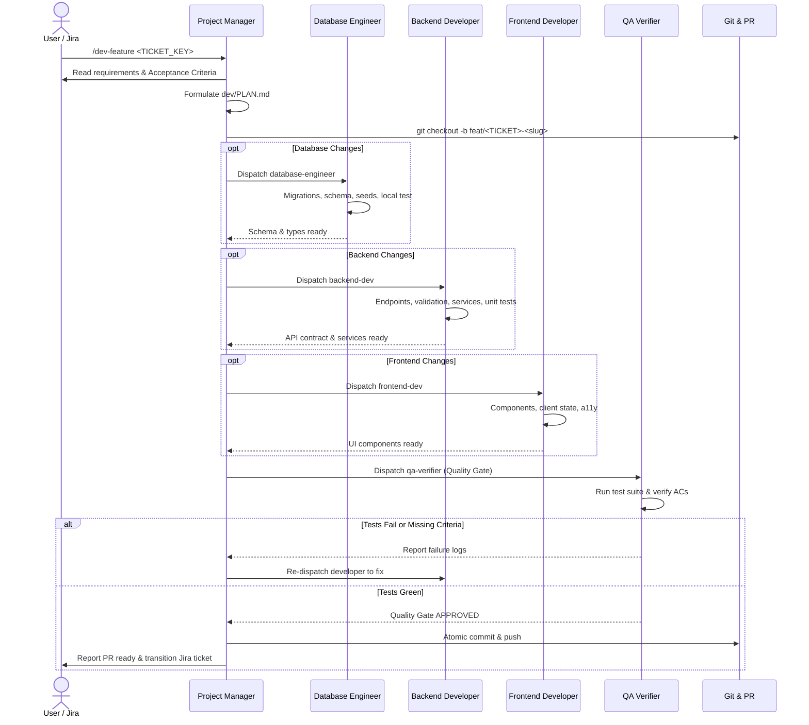

# dev-kit Execution Protocol

This document defines the exact step-by-step procedure the Project Manager / Tech Lead orchestrator follows to resolve tickets and implement features.

---

## The Workflow



---

## Step-by-step Instructions

### Step 1: Ingest Ticket & Context
1. Extract ticket key (e.g. `AK-101`) or user feature brief.
2. If Jira credentials are configured:
   ```bash
   python3 dev-kit/tools/jira_sync.py fetch <TICKET_KEY> --json
   ```
   Transition ticket status to **In Progress**:
   ```bash
   python3 dev-kit/tools/jira_sync.py transition <TICKET_KEY> "In Progress"
   ```
3. Read `dev/project-context.md` (or `dev-kit/templates/project-context.md`) to verify tech stack, package manager, and test commands.

### Step 2: Formulate Technical Plan
1. Create `dev/` directory if missing.
2. Copy `dev-kit/templates/PLAN.md` to `dev/PLAN.md`.
3. Fill in:
   - Problem statement and numbered Acceptance Criteria (`AC-1`, `AC-2`...).
   - Architectural scope (Database, Backend, Frontend).
   - List of exact files to modify or create.
   - Ordered execution steps.

### Step 3: Setup Feature Branch
1. Ensure the working tree is clean on the base branch (`main`).
2. Pull latest changes:
   ```bash
   git checkout main && git pull origin main
   ```
3. Create and switch to the feature branch:
   ```bash
   git checkout -b feat/<TICKET_KEY>-<slug>
   ```

### Step 4: Dispatch Specialized Developers
Dispatch the required specialists in sequential dependency order:

1. **Database Layer (`dev-kit/agents/database.md`)**:
   - *When needed:* Schema alterations, new tables, migrations, database queries.
   - Writes migrations, adds indexes, updates ORM models.
   - Runs migration against local Docker/test database and tests rollback.

2. **Backend Layer (`dev-kit/agents/backend.md`)**:
   - *When needed:* Endpoints, controllers, services, business logic.
   - Implements strict validation schemas (Zod/Pydantic).
   - Writes unit and integration tests.

3. **Frontend Layer (`dev-kit/agents/frontend.md`)**:
   - *When needed:* Pages, components, hooks, client state, styling.
   - Implements loading, error, empty, and success states.
   - Ensures accessibility (a11y) and responsive design.

### Step 5: Quality Gate & Verification (`dev-kit/agents/qa.md`)
Run the independent quality gate:
```bash
python3 dev-kit/tools/test_runner.py --typecheck --lint
```
1. **Zero Failing Tests:** If tests fail, the QA verifier reports failure output back to the PM. The PM re-engages the responsible developer agent to fix the failure.
2. **Acceptance Criteria Verification:** Every AC listed in `dev/PLAN.md` must be validated against actual code.
3. **Diff Hygiene:** Check `git diff` to ensure no temporary files, debug statements, or secrets are tracked.

### Step 6: Git Commit & Hand-off
Once QA approves:
1. Stage modified files and make an atomic conventional commit:
   ```bash
   git add .
   git commit -m "feat(<scope>): <concise description of changes>"
   ```
2. Write `dev/PULL_REQUEST.md` using `dev-kit/templates/PULL_REQUEST.md`, populating the Squad Delivery & Quality Gate Scorecard.
3. If Jira is configured, post comment and transition to *In Review*:
   ```bash
   python3 dev-kit/tools/jira_sync.py transition <TICKET_KEY> "In Review"
   ```

### Step 7: Chat Summary
Report completion in chat (maximum 15 lines):
```
Squad task complete · [TICKET_KEY]: <Title>
Branch: feat/<TICKET_KEY>-<slug>
Delivery Scorecard:
  • Database: [0 migrations · up/down verified]
  • Backend: [<n> endpoints · <n> unit tests]
  • Frontend: [<n> components · 4 states verified]
  • Quality Gate: 🟢 APPROVED (<n> tests green · typecheck clean · lint clean)
Acceptance Criteria: All <n> criteria verified
Pull Request summary: dev/PULL_REQUEST.md
Jira: [TICKET_KEY] transitioned to In Review
```
