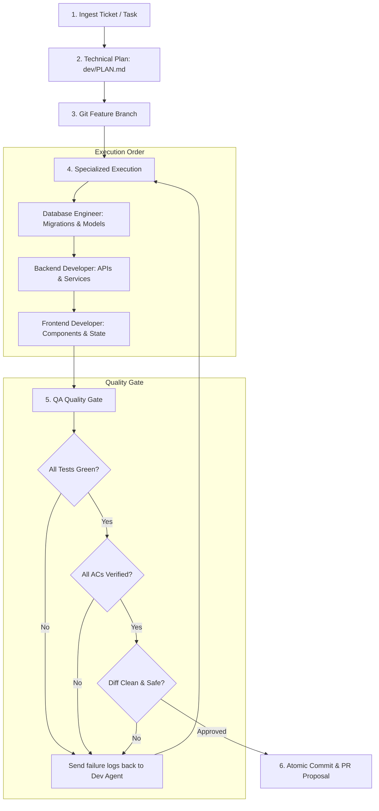

# dev-kit Guide

Complete documentation for `dev-kit`: a portable autonomous software engineering squad for any codebase.

---

## Contents

- [1. What dev-kit is](#1-what-dev-kit-is)
- [2. How it works](#2-how-it-works)
- [3. Setting up a project](#3-setting-up-a-project)
- [4. Commands](#4-commands)
- [5. The Engineering Squad](#5-the-engineering-squad)
  - [Project Manager & Tech Lead (`pm`)](#project-manager--tech-lead-pm)
  - [Database & Persistence Engineer (`database`)](#database--persistence-engineer-database)
  - [Backend & API Developer (`backend`)](#backend--api-developer-backend)
  - [Frontend & UI Developer (`frontend`)](#frontend--ui-developer-frontend)
  - [QA Engineer & Quality Gate (`qa`)](#qa-engineer--quality-gate-qa)
- [6. Safe Database Engineering](#6-safe-database-engineering)
- [7. Testing & Quality Gate](#7-testing--quality-gate)
- [8. Jira Integration](#8-jira-integration)
- [9. Sibling synergy with audit-kit](#9-sibling-synergy-with-audit-kit)
- [10. Troubleshooting](#10-troubleshooting)

---

## 1. What dev-kit is

`dev-kit` turns your AI assistant (Google Antigravity, Claude Code, Cursor, Windsurf) into a structured, multi-role software engineering team.

Instead of asking a single general-purpose prompt to write fullstack code (which often hallucinates database migrations, forgets validation schemas, or introduces regressions), `dev-kit` separates responsibilities into specialized roles with strict quality gates:

* **Project Manager & Tech Lead**: Architects the technical plan and sequences work.
* **Database Engineer**: Models data, writes safe migrations, and adds indexes.
* **Backend Developer**: Builds typed endpoints, validation schemas, and unit tests.
* **Frontend Developer**: Builds accessible UI components and handles all 4 async states.
* **QA Engineer**: Validates acceptance criteria and prevents broken code from being committed.

Drop `dev-kit/` into any repository and run `/dev-feature` on any task or Jira ticket.

---

## 2. How it works

Every development task follows a strict 6-stage lifecycle:



1. **Ingest:** Reads ticket key (e.g. `AK-101`) from Jira or a prompt brief, extracting explicit Acceptance Criteria.
2. **Plan:** The PM agent writes `dev/PLAN.md` documenting affected files, schema changes, and execution order.
3. **Branch:** Creates an isolated git branch (`feat/<TICKET>-<slug>`).
4. **Build:** Dispatches specialists in order (Database $\rightarrow$ Backend $\rightarrow$ Frontend).
5. **Verify:** The QA agent runs `tools/test_runner.py` and inspects `git diff`.
6. **Deliver:** Writes `dev/PULL_REQUEST.md`, commits cleanly, and updates Jira status.

---

## 3. Setting up a project

### 1. Install dev-kit
From the root of your target project:
```bash
curl -fsSL https://raw.githubusercontent.com/victorfigueira/dev-kit/main/get.sh | bash
```

To install for one tool only, append its name:
```bash
... | bash -s -- antigravity   # or claude, cursor
```

### 2. Configure Git Ignore
Keep squad working notes and temporary files out of git:
```bash
echo "dev/" >> .gitignore
echo "dev-kit/" >> .gitignore
```

### 3. Configure Project Context (Optional)
Copy the template to customize your stack's specific commands:
```bash
mkdir -p dev
cp dev-kit/templates/project-context.md dev/project-context.md
```
Edit `dev/project-context.md` to specify:
* Your exact test command (e.g. `npm test`, `pytest`, `cargo test`).
* Typecheck and linting commands (`npm run typecheck`, `mypy .`).
* Database migration commands (`npx prisma migrate dev`, `alembic upgrade head`).

---

## 4. Commands

### Chat Commands (Slash Commands)

| Command | Usage | Description |
|---|---|---|
| `/dev-feature` | `/dev-feature <TICKET_KEY>` | Launches the full squad pipeline: PM plans, devs implement, QA verifies and opens PR. |
| `/dev-qa` | `/dev-qa` | Runs the QA Quality Gate independently on the current git diff. |

### CLI Tools

All scripts run with standard Python 3 and zero third-party dependencies:

```bash
# Run universal test suite detector & runner
python3 dev-kit/tools/test_runner.py [--typecheck] [--lint] [--json]

# Fetch Jira ticket details and acceptance criteria
python3 dev-kit/tools/jira_sync.py fetch <TICKET_KEY> [--json]

# Transition Jira ticket status
python3 dev-kit/tools/jira_sync.py transition <TICKET_KEY> "In Progress"

# Post comment with PR test summary
python3 dev-kit/tools/jira_sync.py comment <TICKET_KEY> "PR ready with tests passing."
```

---

## 5. The Engineering Squad

### Project Manager & Tech Lead (`pm`)
* **File:** `dev-kit/agents/pm.md`
* **Role:** Architectural planning and dispatch.
* **Output:** `dev/PLAN.md`.
* The PM never writes application code directly. Its duty is to break down requirements into clear, verifiable steps and ensure the right specialist is invoked at the right time.

### Database & Persistence Engineer (`database`)
* **File:** `dev-kit/agents/database.md`
* **Role:** Data modeling, schema migrations, query performance, and test seeds.
* **Safety Rule:** Runs migrations exclusively against local Docker or test databases. Never touches production connections.

### Backend & API Developer (`backend`)
* **File:** `dev-kit/agents/backend.md`
* **Role:** REST/GraphQL endpoints, business logic, validation schemas, and automated unit tests.
* **Safety Rule:** Mandatory validation schemas on all inputs; structured error handling with zero database error leakage.

### Frontend & UI Developer (`frontend`)
* **File:** `dev-kit/agents/frontend.md`
* **Role:** UI components, client state, styling tokens, and accessibility (a11y).
* **Safety Rule:** Mandatory implementation of all 4 async states (Loading, Error, Empty, Success).

### QA Engineer & Quality Gate (`qa`)
* **File:** `dev-kit/agents/qa.md`
* **Role:** Independent quality verification.
* **Safety Rule:** The Quality Gate is non-negotiable. Code with failing tests or unverified acceptance criteria is rejected and returned to the developer agent with failure logs.

---

## 6. Safe Database Engineering

Database mistakes are the most dangerous and costly to revert in production. `dev-kit` enforces strict persistence standards in `RULES.md`:

### The Expand & Contract Pattern
When changing a schema, never execute breaking changes in a single step:
1. **Expand:** Add new columns as nullable (`NULL`) or with safe default values.
2. **Migrate:** Write code that reads from both old and new columns, writing to the new column.
3. **Contract:** Remove the old deprecated column in a subsequent release after data is confirmed.

### Reversible Migrations
Every migration generated by the `database-engineer` must include both:
* `up`: applies the change.
* `down`: cleanly rolls back the change without leaving orphaned rows or corrupted schemas.

---

## 7. Testing & Quality Gate

`dev-kit/tools/test_runner.py` automatically detects your project's technology stack:
* **Node.js:** detects `package.json` with npm, pnpm, yarn, or bun.
* **Python:** detects `pytest.ini`, `pyproject.toml`, or `requirements.txt`.
* **Go:** detects `go.mod` (`go test ./...`).
* **Rust:** detects `Cargo.toml` (`cargo test`, `cargo check`, `cargo clippy`).
* **.NET:** detects `*.csproj` or `*.sln` (`dotnet test`).

You can also define custom commands in `dev/project-context.md`.

---

## 8. Jira Integration

`dev-kit` integrates natively with Atlassian Jira Cloud using standard environment variables:

```bash
export JIRA_BASE_URL="https://your-company.atlassian.net"
export JIRA_USER_EMAIL="developer@your-company.com"
export JIRA_API_TOKEN="your-atlassian-api-token"
```

* **Offline Fallback:** If Jira credentials are not present, `jira_sync.py` falls back gracefully to local mock mode so developers can run `dev-kit` without network access.
* **Acceptance Criteria Extraction:** Automatically parses markdown checkboxes (`- [ ]`) and numbered lists (`AC-1:`) from the ticket description.

---

## 9. Sibling synergy with audit-kit

`audit-kit` and `dev-kit` form a closed-loop engineering cycle:

1. **Audit:** Run `/audit` with `audit-kit`. It identifies security vulnerabilities (with CVSS scores), technical debt, and performance bottlenecks.
2. **Ticket Filing:** Run `/audit-jira` to create structured tickets in your backlog.
3. **Development:** Run `/dev-feature <TICKET_KEY>` with `dev-kit`. The squad designs the fix, writes the code, passes tests, and opens a PR.
4. **Verification:** Run `/audit-diff` with `audit-kit` on the PR. It validates that the vulnerability is resolved and automatically updates the project audit score.

---

## 10. Troubleshooting

### Tests fail during the QA Quality Gate
Inspect the failure output printed in chat. The PM orchestrator will re-dispatch the developer agent with the exact failure stack trace. You can also run:
```bash
python3 dev-kit/tools/test_runner.py
```
directly to inspect the stdout/stderr.

### Database migration fails
Confirm that your local database container (e.g. Docker PostgreSQL) is running. Check connection strings in `.env.local` or `dev/project-context.md`.
